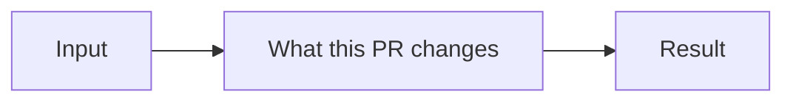

<!--
Thanks for contributing to <project>. PRs target `<base-branch>`.
Fill in the sections that apply and delete the rest, including this comment.
-->

## Summary

<!-- One or two sentences: what this changes and why. Link the issue it closes. -->

## Changes

<!--
The notable changes. Call out anything that changes the public surface: commands, flags,
APIs, config, or what gets published.
-->

## Diagram (optional)

<!--
For a non-trivial flow, architecture, or before/after behavior, a Mermaid diagram renders
inline on GitHub. Delete this section if a diagram wouldn't make the change clearer.
-->



## How to verify

<!-- The commands or steps a reviewer can run to see it working. -->

```bash
npm run build
npm test
```

## Checklist

- [ ] `npm run lint` passes
- [ ] `npm run format:check` passes
- [ ] `npm test` passes
- [ ] `npm run build` succeeds
- [ ] Docs (README, AGENTS.md, CHANGELOG) updated if behavior or the public surface changed
- [ ] No secrets or credentials committed

## Notes

<!-- Optional: follow-ups, known limitations, or anything reviewers should look at first. -->
